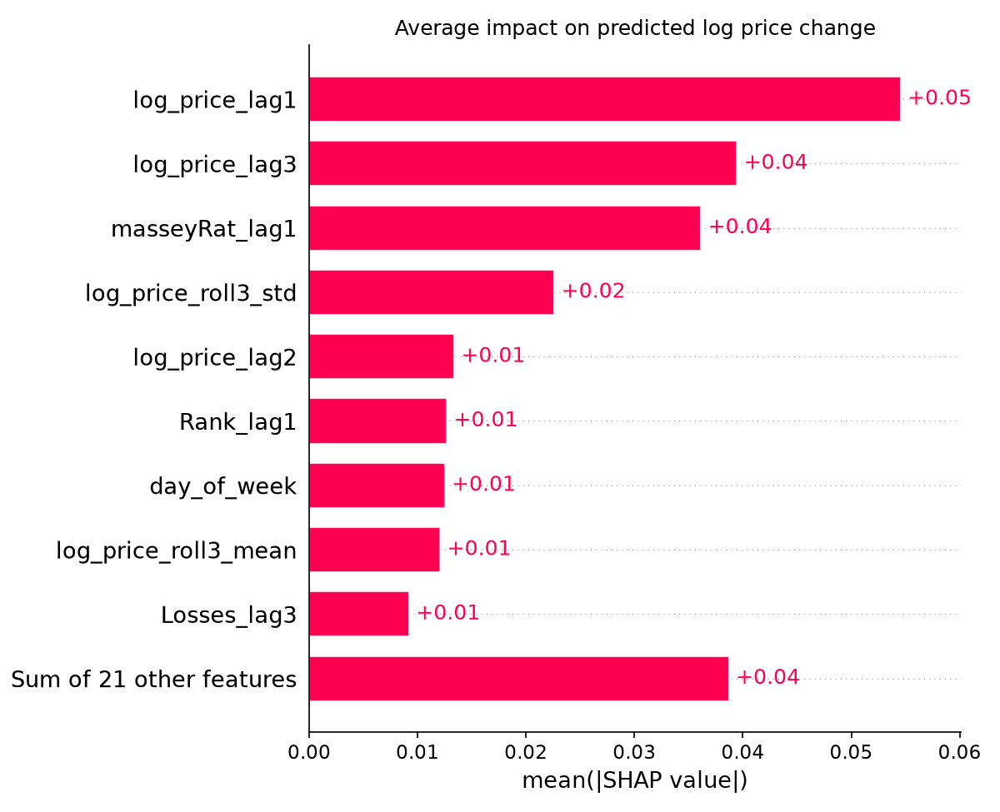
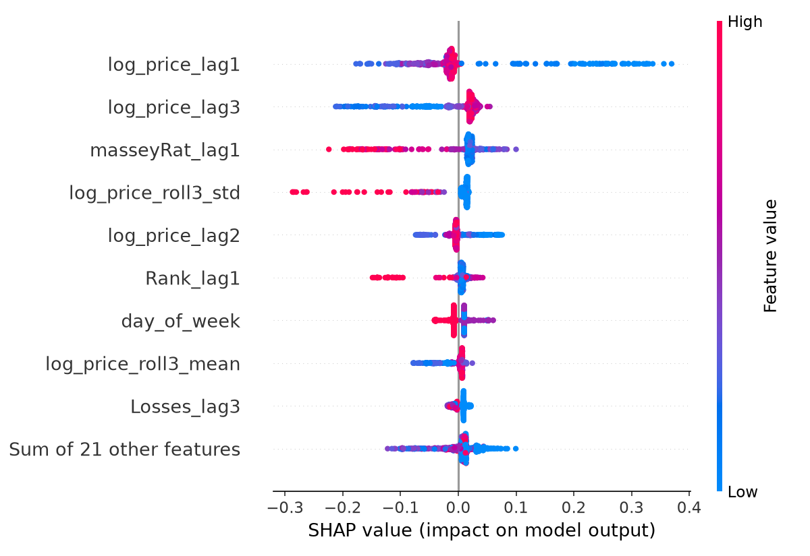
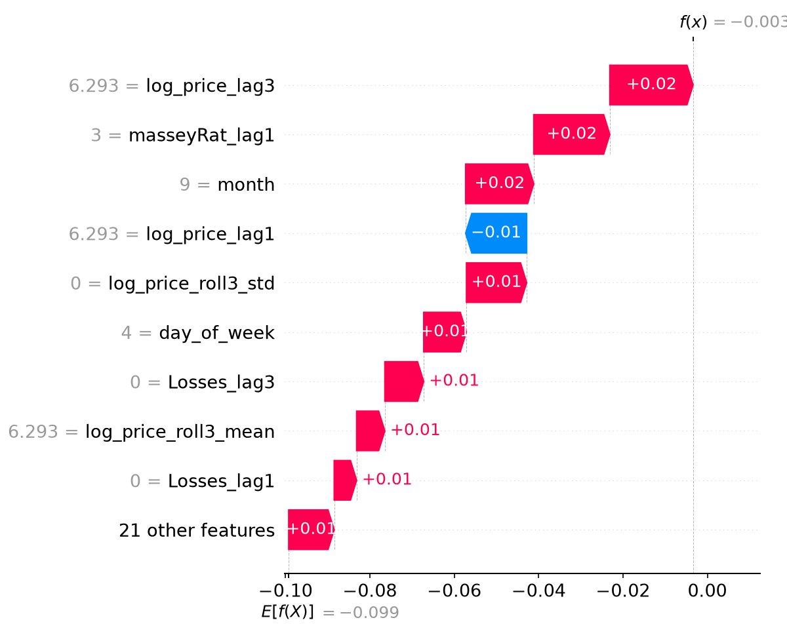

# Recap

## What We Know: Partitions

- Divides a dataset into training, validation (sometimes), and test sets.

- **Training**: Used to train the model. Anywhere between 60-80% of the data.

- **Validation**: Used to tune hyperparameters and prevent overfitting. Typically 10-20% of the data.

- **Test**: Used to evaluate the final model's performance on unseen data.

## What We Know: Partition Problems

- **Leakage** can occur if the validation or test sets contain information from the training set.

- An easy way to avoid leakage is to split your data before any preprocessing steps.

## What We Learned: XGBoost

- A tree-based ensemble method that uses gradient boosting to improve a weak base learner.

- Uses internal regularization to prevent overfitting and improve generalization.

- Great for non-linear relationships, implicit interactions between features, and missing data.

- Each tree is built sequentially, with each new tree attempting to correct the errors of the previous trees.

- **Trees don't vote**, but go until a stopping criterion is met or the residuals stop improving.

## What We Learned: XGBoost Regularization

- L1 ($\alpha$): Helps with feature selection by shrinking the coefficients of less important features to zero.

- L2 ($\lambda$): Helps with preventing overfitting by adding a penalty term to the loss function.

- Increasing the regularization parameters will make the model more conservative and less likely to overfit.

## {.center}

:::{.callout-tip}
There are many hyperparameters to tune in XGBoost. Don't get overwhelmed! Start with what we've learned and slowly start adding new ones! Learning how to tune hyperparameters is a skill that takes time to develop. Start with the basics and build from there.
:::

# What We Learned: Plotting Shapley Values

::: {.columns}

::: {.column width="50%"}
Shap plots are a way to visualize the contribution of each feature to the model's predictions.
:::

::: {.column width="50%"}

:::

:::

## {.center}

::: {.columns}

::: {.column width="50%"}
Beeswarm plots show the average magnitude and direction of the Shapley values for each feature.
:::

::: {.column width="50%"}

:::

:::

## {.center}

::: {.columns}

::: {.column width="50%"}
Waterfall plots show the contribution of each feature to a single prediction, starting from the base value and adding/subtracting the Shapley values for each feature.
:::

::: {.column width="50%"}

:::

:::

# What We Need To Know

## Temporal Partitions

- We cannot use a normal random split for time series data because it would destroy the temporal order of the data.

- Traditional train/test splits assume that the data is **independent and identically distributed** (i.i.d.), which is not the case for time series data.

- Instead, we need to use time-based splits.

- This ensures that the model is trained on past data and tested on future data.

## Time Series Cross-Validation

- We'll use `TimeSeriesSplit` from sklearn to perform cross-validation on time series data.

- This method splits the data into multiple train/test sets, where each test set is a contiguous block of time that follows the training set.

- "Successive training sets are supersets of those that come before them in time."

## Hyperparameter Tuning

- Once we get one model up and running, we can use `HalvingGridSearchCV` to tune the hyperparameters of the XGBoost model.

- This method performs a **grid search** over a specified parameter grid, but instead of evaluating all combinations of parameters, it uses a halving strategy to iteratively eliminate the worst-performing candidates.

## Tuning Strategies {.center}

| Grid Search | Random Search |  Halving Grid Search |
|-------------|---------------|--------------------|
| Exhaustive search over all combinations of hyperparameters | Randomly samples hyperparameter combinations |  Iteratively eliminates the worst-performing candidates
|Slower and more computationally expensive | Faster than grid search, but may miss the optimal combination |  More efficient than grid search and random search, but may require more iterations to converge

## 

```{python}
#| echo: true
#| output-location: slide
from sklearn.metrics import mean_absolute_error, root_mean_squared_error
from sklearn.experimental import enable_halving_search_cv 
from sklearn.model_selection import HalvingGridSearchCV, TimeSeriesSplit
from xgboost import XGBRegressor

tscv = TimeSeriesSplit(n_splits=5)

param_grid = {
    "max_depth": [2, 3, 4],
    "learning_rate": [0.03, 0.05, 0.1],
    "min_child_weight": [1, 5, 10],
    "reg_lambda": [1, 10],
}

search = HalvingGridSearchCV(
    XGBRegressor(subsample=0.8, colsample_bytree=0.8, random_state=42),
    param_grid,
    resource="n_estimators",
    min_resources=50,
    max_resources=300,
    factor=3,
    scoring="neg_mean_absolute_error",
    cv=tscv,
    random_state=42,
)
```

## Target Variable

- To use XGBoost for time series forecasting, we need to define a target variable that represents the future value we want to predict.

- We can't use the absolute value of the target variable, since trees are not scale-invariant.

- Instead, we can use differences, percent changes, or other transformations that make the target variable more suitable for tree-based models.

## Creating Temporal Features

- We need to create features that capture the temporal patterns in the data, such as lagged values, rolling averages, and seasonal indicators.

- We also need to consider the impact of external factors, that may influence the target variable.

## Our Tasks

- Explore our data to determine what we want to use.

- Use TimeSeriesSplit to evaluate the model's performance.

- Build a model to predict the magnitude of the price change.

- Create lagged features and rolling windows for our features.

- Create a markdown file that explains everything.

- Build a clear and specific prompt to achieve the above tasks.